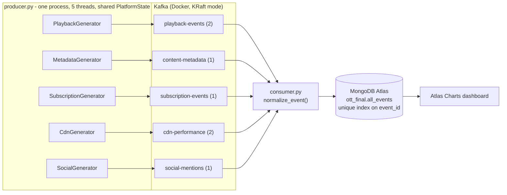

# Media / OTT Real-Time Operations — Final Project Answers (corrected)

These replace the earlier answers. Every number here matches the code in this folder.
Numbers marked *(simulation)* come from `tools/validate_dashboard.py`; replace them with
your own live dashboard numbers before presenting.

---

## 1. Problem Statement (25%)

On an OTT platform, one failing piece of infrastructure shows up in four different systems run by four different teams. When a CDN edge node degrades, the player logs buffering, viewers abandon what they were watching, complaints appear on social media, and cancellations rise in billing. A separate risk runs in the background: titles can keep streaming after their licence window has ended, which is direct legal exposure.

Today these signals sit in five separate systems (player app, content catalogue, billing gateway, CDN telemetry, social listening) that are usually reconciled in a nightly or weekly batch report. By then the viewer has already left, the cancellation is already processed, and the expired title has streamed all day.

This project streams all five sources through Kafka into one MongoDB Atlas collection, normalised to a single schema with shared keys (`session_id`, `user_id`, `title_id`, `region`, `cdn_node`). One dashboard then shows, within a minute, which node is failing, which region it is hurting, how much revenue is at risk, and which titles are being played without a valid licence.

**Why streaming, not batch:** the cost of delay is asymmetric. A buffering viewer decides to leave in minutes, so the reroute decision is worth most in the first minutes. A failed payment retried the same day is often recovered. A licence breach accrues exposure every hour it stays live. Batch turns each of these into a post-mortem; streaming turns them into a same-minute operational decision.

*(~280 words)*

---

## 2. Identification of Data (20%)

Five source systems, each publishing to its own Kafka topic (`localhost:9092`), all converging into one collection, `ott_final.all_events`.

| # | Source system | Kafka topic | Partitions | Message key | Rate (simulated) | Per day |
|---|---|---|---|---|---|---|
| 1 | Viewer / Player App | `playback-events` | 2 | `session_id` | 5 /sec | ~432,000 |
| 2 | CDN / Player Telemetry | `cdn-performance` | 2 | `cdn_node` | 2 /sec | ~172,800 |
| 3 | Billing & Subscription Gateway | `subscription-events` | 1 | `user_id` | 1 /sec | ~86,400 |
| 4 | Social Listening | `social-mentions` | 1 | `title_id` | ~0.67 /sec | ~57,600 |
| 5 | Content Catalogue & Licensing | `content-metadata` | 1 | `title_id` | 0.2 /sec | ~17,300 |
| | **Total** | | | | **~8.9 /sec** | **~770,000** |

**Why these ratios:** playback dominates real OTT traffic because every active viewer sends frequent heartbeats; catalogue changes are rare. The two highest-volume topics get 2 partitions.

**Volume at real scale:** 1 million concurrent viewers sending one heartbeat every 30 seconds is about 33,000 playback events per second. The same design scales by adding partitions and consumer instances.

**Storage:** about 300+ MB/day at the simulated rate. The free Atlas M0 tier caps at 512 MB, so `consumer.py` sets a 12-hour auto-delete (TTL) index.

### Schemas (as produced by `producer.py`)

**1. `playback-events`** — what is being watched, session by session.
`event_id`, `timestamp`, `user_id`, `session_id`, `title_id`, `title`, `genre`, `language`, `license_status` (active / expiring_24h / expired), `event_type` (play_start / progress / pause / resume / seek / buffering / abandon / complete), `device`, `watch_position_sec`, `content_duration_sec`, `watch_completion_pct`, `session_quality`, `region`, `cdn_node`, `plan`.

**2. `cdn-performance`** — delivery quality of a live session.
`event_id`, `timestamp`, `session_id`, `user_id`, `title_id` (all three taken from a real active playback session), `cdn_node`, `region`, `latency_ms`, `bitrate_mbps`, `buffering_rate_pct`, `error_code`.

**3. `subscription-events`** — revenue-affecting account activity.
`event_id`, `timestamp`, `user_id`, `subscription_action` (renewal / plan_upgrade / plan_downgrade / payment_failed / payment_retry_success / cancellation / reactivation), `plan`, `plan_price_inr`, `region`, `cdn_node`.

**4. `social-mentions`** — public conversation about titles.
`event_id`, `timestamp`, `title_id`, `title`, `genre`, `platform`, `text`, `sentiment` (positive / negative), `region`, `cdn_node`.

**5. `content-metadata`** — legal availability of the catalogue.
`event_id`, `timestamp`, `title_id`, `title`, `genre`, `language`, `content_rating`, `licensing_window_end`, `license_status`, `update_type` (new_release / metadata_update / availability_check / license_expiring_soon / license_expired).

### Unification
`normalize_event()` in `consumer.py` folds every event into one document shape. Every document gets `source`, `kafka_topic`, `timestamp` (stored as a real Date) and `ingested_at` (when it reached the consumer). Fields a source does not have are left out rather than stored as null.

The shared keys come from one catalogue used by all five generators: `session_id`, `user_id`, `title_id`, `region` and `cdn_node`. Because of this, events from different topics about the same viewer, title, region or edge node can be grouped together in one query.

### How the sources are linked (and why it matters)
Each region is served by one CDN edge node. When a node degrades, the effect propagates into the other streams the way it would on a real platform:
- **CDN:** latency and buffering rise on that node.
- **Playback:** sessions in that region buffer and get abandoned.
- **Social:** buffering complaints rise in that region.
- **Billing:** cancellations rise in that region.

The data is simulated, but these effects are causally linked, not independent random numbers.

---

## 3. Technical Working — Architecture (15%)

**Pipeline:** `producer.py` → Kafka (Docker) → `consumer.py` → MongoDB Atlas → Atlas Charts

**1. Producer (`producer.py`)**
- One process with five generator threads.
- The threads share one catalogue (titles, users, regions, CDN nodes) and one live `PlatformState` object. That object holds node health and active sessions, which is how a CDN incident affects playback, social and billing.
- All threads send through a single `KafkaProducer` (`kafka-python`) with `acks="all"`, JSON serialisation and a message key per topic.
- Keys matter: playback is keyed by `session_id`, so all events of one viewing session land in the same partition and stay in order.
- Sends are asynchronous (`linger_ms=20`) and flushed on shutdown.
- **Live incident control:** typing a node name (e.g. `edge-mum-01`) in the producer terminal degrades that node for 3 minutes. `status` and `clear` are also available.
- `python producer.py cdn` runs a single source.

**2. Broker (Kafka)**
- Runs locally in Docker as a single `apache/kafka` container (`ott-kafka`) in **KRaft mode**. Kafka manages its own metadata, so no ZooKeeper is needed; this is the modern Kafka architecture.
- Broker at `localhost:9092`.
- The five topics were created explicitly with `kafka-topics.sh`, so partition counts are deliberate rather than defaults: `playback-events` 2, `cdn-performance` 2, the other three 1. Replication factor 1, since it's a single broker; production would use 3.

**3. Consumer (`consumer.py`)**
- One `KafkaConsumer` subscribed to all five topics, in consumer group `ott-vertical-consumer`, with `auto_offset_reset="earliest"` and **manual offset commits**: the offset is committed only after the documents are safely written to Atlas.
- Each message goes through `normalize_event()`, which turns ISO timestamp strings into real Dates and stamps `ingested_at`.

**Delivery guarantee (stated correctly):**
- **At-least-once.** Kafka offsets are committed only *after* the write to Atlas succeeds. If the consumer crashes before committing, Kafka re-delivers those messages.
- **Idempotent writes.** A unique index on `event_id` turns a re-delivered message into a `DuplicateKeyError`, which is skipped and counted. Result: no data loss and no duplicate documents (effectively-once storage).
- **Atlas outages.** If Atlas becomes unreachable (network drop, blocked IP), the consumer does not skip events. It waits and retries with back-off (5 s, 10 s, 20 s … up to 60 s) while Kafka holds the backlog, then catches up. We hit exactly this in testing, when the laptop's Wi-Fi reconnected with a new IP. The first version of the consumer skipped events during the outage; this version waits instead.

**4. Storage (MongoDB Atlas)**
- `pymongo` connects with TLS via `certifi` and `ServerApi("1")`.
- The URI comes from `.env` and is never hardcoded.
- The client pings Atlas on startup, so a wrong password or blocked IP fails immediately.
- On startup the consumer creates four indexes:
  - unique `event_id` (idempotency)
  - `timestamp` and `source + timestamp` (fast "last 15 minutes" queries)
  - a 12-hour TTL on `ingested_at` (stays under the 512 MB free-tier limit)

**5. Dashboard (Atlas Charts)**
- 25 tiles read directly from `all_events`, plus one hand-added tile.
- "Last N minutes" metrics use calculated fields with `$$NOW`.
- Pipeline lag is measured live as `ingested_at − timestamp`.

**Tools:** Python 3, `kafka-python`, `pymongo`, `python-dotenv`, `certifi`, Docker (`apache/kafka`, KRaft mode), MongoDB Atlas (free M0 cluster), MongoDB Atlas Charts.

---

## 4. Charts & Visualisations (30%)

Dashboard: `dashboards/OTT_Media_Final_Dashboard.charts`, 8 KPI cards + 17 charts, plus 1 hand-added chart. Dashboard filters: Region, CDN node, Source, Title, User.

**Row A — Is the platform healthy right now? (last 15 minutes)**

| Tile | Business insight |
|---|---|
| Events – last 15 min | proof the pipeline is live and flowing |
| Pipeline Lag (sec) | measured end-to-end freshness: how old the data on screen is |
| Avg Buffering % (red > 5) | platform-wide viewer experience right now |
| Revenue at Risk ₹ (amber > 0) | cancellations + failed payments × plan price; the money question in one number |

**Row B — Standing risks**

| Tile | Business insight |
|---|---|
| Plays on EXPIRED Licences (red) | titles still streaming after their licence ended; legal exposure |
| Payment Failures (amber) | recoverable revenue if retried the same day |
| CDN Errors (red) | hard playback failures viewers actually hit |
| Negative Social % (red > 40) | brand damage building in public |

**Charts**

| # | Chart | Business insight |
|---|---|---|
| 1 | Buffering % by CDN Node per Minute (heatmap, 30 min) | an incident appears as a hot band on one node; tells ops *where* and *since when* |
| 2–5 | Buffering %, Abandon Rate %, Negative Social %, Cancellations, each by Region (15 min) | four different source systems, the same region lights up in all four; shows the *business cost* of one node failing |
| 6 | Events per Minute by Source (30 min) | pipeline health; a stalled producer shows as a missing colour |
| 7 | Events by Source | volume mix; playback dominates, as in a real OTT |
| 8 | Avg Watch Completion % by Genre (finished sessions only) | which genres hold viewers to the end |
| 9 | Session Outcome by Stream Quality | poor-quality streams end in abandonment far more often |
| 10 | Subscription Actions | renewal vs churn vs plan changes |
| 11 | Subscriber Plan Mix | revenue tier distribution |
| 12 | Avg Latency by CDN Node | which node needs capacity |
| 13 | CDN Error Codes | DRM vs manifest vs timeout: which team owns the fix |
| 14 | Mentions by Title and Sentiment | which titles drive praise vs complaints |
| 15 | Social Mentions by Platform | where to put community-management effort |
| 16 | Plays on Expired / Expiring Licences by Title | the exact titles content/legal must pull or renew today |
| 17 | Playback Device Mix | where to focus player QA |
| 18 | Buffering: Abandoned vs Completed Sessions *(added by hand)* | joins CDN to playback per session; direct evidence that buffering causes abandonment |

**Key insights** *(simulation; replace with live numbers)*
1. **Buffering predicts abandonment.**
   - Abandoned sessions averaged 5.6% buffering vs 1.5% for completed ones (3.7×).
   - Decision: auto-reroute a region when its node's buffering crosses ~5%.
2. **One node failure hits four teams at once.**
   - During the edge-mum-01 incident, IN-West led every region on buffering (10.2% vs ~1.5%), abandonment (68% vs a 22% baseline), negative social (72%), and cancellations (39 vs ≤13 elsewhere).
3. **Revenue at risk is visible in real time,** not at month end.
4. **Licensing is a live compliance issue.**
   - Expired titles are still being played (Saffron Street, Midnight Signal).
   - Decision: block playback automatically when `license_status = expired`.

---

## 5. Discussion (10%)

**Business implications:** ops reroutes traffic, growth runs win-back offers in the affected region, support pre-empts complaints, and legal pulls expired titles. All four act from the same screen within minutes instead of the next day.

**Future roadmap:**
- Atlas Triggers to fire alerts (Slack or email) when a threshold is crossed.
- Automated CDN failover driven by the buffering signal.
- A per-session ML churn score.
- A schema registry for versioned event schemas.
- Managed Kafka with more partitions and consumer instances for production scale.
- A columnar or time-series store for long-term analytics behind the same Kafka layer.

**Honest limitations:**
- The data is simulated.
- The free Atlas tier auto-refreshes dashboards only every 4 hours, so the live demo uses manual refresh.
- MongoDB was chosen for native dashboarding at coursework scale, not as the throughput-optimal store.
